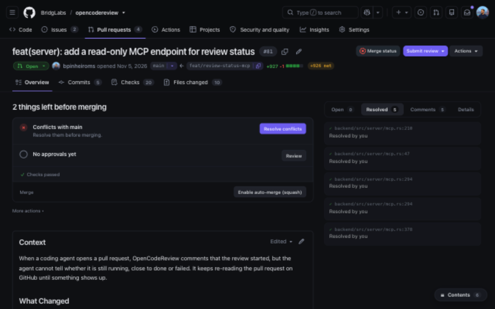

# Refine for GitHub

Extensão do Chrome (Manifest V3) que coloca uma camada de design por cima do GitHub, com foco na página de pull request: o que falta para o merge, conversas num painel lateral, checks e listas compactas. Lê só a página aberta: sem API, sem token, sem analytics.



## Publicar na Chrome Web Store

1. `./scripts/package.sh` gera `dist/refine-for-github-<versão>.zip` (só a pasta `extension/`).
2. No [Developer Dashboard](https://chrome.google.com/webstore/devconsole), envie o zip.
3. Preencha a listagem com o texto e as imagens de [`store/LISTING.md`](store/LISTING.md) (descrição, justificativa das permissões, privacidade, capturas 1280×800, tiles promocionais).
4. Publique [`PRIVACY.md`](PRIVACY.md) num endereço público (gist ou GitHub Pages) e cole o link no campo de política de privacidade.
5. Para cada nova versão: suba `version` em `extension/manifest.json` e gere o zip de novo.

## Instalar (modo dev)

1. `chrome://extensions` → ligue **Modo do desenvolvedor**
2. **Carregar sem compactação** → selecione a pasta `extension/`
3. Abra qualquer página do github.com e clique no ícone da extensão para ligar/desligar recursos

Depois de editar o código: botão ⟳ da extensão em `chrome://extensions` + recarregar a aba.

## Recursos

| Recurso | O que faz |
| --- | --- |
| Tema Grafite | Paleta escura mais neutra, fonte Inter/SF, cantos maiores, acento configurável (violeta, azul, verde, laranja) |
| Listas em cartões | Cada PR/issue vira um cartão com faixa colorida por estado (aberto, draft, merged, fechado) |
| Agrupar bots | PRs do Dependabot/Renovate e `build(deps)` vão para o fim da lista, recolhidos em "N atualizações de dependências" |
| Esmaecer rascunhos | Drafts ficam com 55% de opacidade e ganham a etiqueta "Rascunho" |
| Leitura confortável | `.markdown-body` (descrição do PR, comentários, README) com linha de ~78 caracteres e mais respiro |
| Página do PR: cabeçalho | Selo de estado (Open/Merged/Closed/Draft) vira pílula suave na cor do estado; branches como chips monoespaçados; contadores das abas discretos |
| Página do PR: índice | Botão flutuante "Índice" lista os títulos da descrição, rola até eles e destaca a seção visível |
| Página do PR: barra lateral compacta | Seções vazias (Reviewers, Labels, Milestone... com "None yet") viram uma linha só, esmaecidas; as preenchidas se destacam |
| Página do PR: número | `#123` visível ao lado do título (a página nova só mostra no cabeçalho fixo); clique copia, Shift+clique copia o link |
| Página do PR: o que falta para o merge | A Overview vira uma lista de pendências com a ação de cada uma: checks (os que falharam com nome, tempo e "Required"; os que passaram recolhidos), conversas sem resolver, aprovação e conflitos; os botões de merge da própria página ficam no rodapé. À direita, no lugar da barra lateral, um painel fixo com abas (Unresolved, Resolved, Comments, Details): clicar num card abre um modal com a conversa inteira (trecho do diff + respostas) e um campo para responder (⌘↵) ou responder e resolver; a aba Details mostra a barra lateral original do GitHub (revisores, labels…), que continua editável. Descrição aberta. Tudo lido da própria página, sem API e sem token |
| Página do PR: atalho p/ modo antigo | Destaca o seletor "Preview" do GitHub, por onde se volta à interface antiga |
| Modo debug | Contorna o que a extensão reconheceu na página, para achar o que quebrou quando o GitHub mudar |

## Como a página é alterada

```
popup ──chrome.storage──▶ content.js ──▶ <html data-gr-theme data-gr-cards ...>
                              │
                              └─ MutationObserver ──▶ marca elementos: data-gr-row, data-gr-state, data-gr-bot
                                                            │
refine.css ◀───────────── só mira em data-gr-* ◀────────────┘
```

1. **Tokens do Primer.** O GitHub inteiro usa variáveis CSS (`--bgColor-default`, `--fgColor-accent`, `--borderRadius-medium`...). Redefinir essas variáveis no `<html>` muda o tema do site todo com poucas linhas, e sobrevive a redesigns de componentes.
2. **Marcação semântica.** O GitHub novo é React com classes geradas (`prc-ListView-…`), que mudam a cada deploy. O `content.js` acha os elementos por pistas estáveis (links `/pull/123`, ícones `octicon-*`, `aria-label`, autor com hovercard) e grava atributos próprios (`data-gr-row`, `data-gr-state="draft"`, `data-gr-bot`). O CSS mira só nesses atributos. Quando o GitHub mudar o HTML, só a detecção precisa de ajuste.
3. **Opções = atributos no `<html>`.** Cada opção do popup vira `data-gr-<opção>`, e todo o CSS depende desses atributos. Ligar ou desligar é instantâneo, sem recarregar, e não deixa resto.
4. **Respeitar o React.** Não movemos nem apagamos nós que o React controla (isso derruba a página). Para reordenar usamos `order` em flexbox; para esconder, `display: none`. Só inserimos dois nós: o botão dos bots (dentro da lista) e o índice do PR (direto no `<body>`, fora do React).
5. **Navegação SPA.** O GitHub troca de página sem recarregar (Turbo/React). Um `MutationObserver` com throttle por frame remarca a página a cada mudança: navegação, filtros, paginação.
6. **Sem piscar.** As configurações ficam em cache no `localStorage` do github.com e são aplicadas no `document_start`, antes da primeira pintura.

## Protótipo

`prototype/index.html` (lista de PRs, dados de exemplo) e `prototype/overview.html` (Overview de uma PR pública) imitam o GitHub e rodam o **mesmo** `content.js` + `refine.css` (com um stub de `chrome.storage`). Abra o arquivo direto no navegador. `python3 prototype/build.py` gera versões em arquivo único em `prototype/dist/` (ignorado pelo Git).

## Bancada com o HTML real do GitHub

`prototype/real/build.py` baixa páginas de PR públicas, tira os scripts do GitHub e injeta a extensão inteira, para testar a detecção no HTML de verdade.

```
python3 prototype/real/build.py BridgLabs/opencodereview 104 101
cd prototype/real && python3 -m http.server 8766
# http://127.0.0.1:8766/BridgLabs/opencodereview/pull/104/
```

`prototype/overview.html` é o protótipo de design (antes/depois) da Overview.

## Próximas ideias

- Página do PR: checks resumidos como pílulas no cabeçalho, caixa "Merged" mais discreta
- Tema claro próprio (hoje só o escuro tem paleta própria)
- Atalhos de teclado (j/k para navegar nos cartões)
- Regras por repositório (ex.: esconder bots só em um repositório)

## Segurança e contribuições

- Vulnerabilidades: veja [`SECURITY.md`](SECURITY.md) (relato privado pela aba Security).
- `main` é protegida: mudanças entram só por pull request com squash, histórico linear e o check `check` do CI passando.
- O código é público para leitura e auditoria. Sem arquivo de licença, todos os direitos ficam reservados ao autor.
