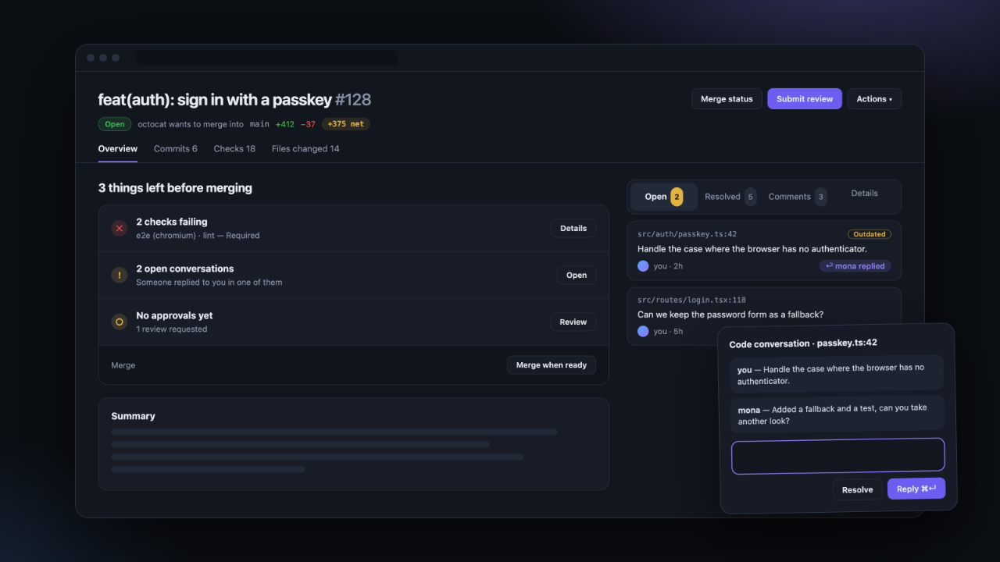

# Refine for GitHub

A Chrome and Firefox extension (Manifest V3) that adds a design layer on top of GitHub, focused on the pull request page: what is left before merging, conversations in a side panel, readable checks and compact lists. It only reads the page you have open: no API, no token, no analytics.



## Features

| Area | What it does |
| --- | --- |
| Pull request Overview | "N things left before merging": failing checks, missing approvals, conflicts and unresolved conversations, each with its action. GitHub's own merge buttons stay at the bottom. |
| Side panel | Open, Resolved, Comments and Details tabs. Open conversations show who replied last. Details shows GitHub's sidebar (reviewers, labels…), still editable. |
| Conversation drawer | Click a conversation to read it in a right-side drawer, reply (⌘↵) or reply and resolve. |
| Header | Title, state, branches and net lines (`+N net`) on one row; Preview, Code, notifications and panel toggles grouped in one Actions menu; the sticky bar only appears on scroll. |
| Merge status and checks | Checks grouped by state with colored markers, reviewers expanded, repeated messages removed. Merge status, Comments, Activity and check details open as right-side drawers. |
| Merge queue | Entry status shown as a badge, stats as cards, full width. |
| Files changed | Same header as the Overview, quiet `@@` hunk rows, full width. |
| Lists | Pull requests and issues as cards with a state stripe; drafts and dependency updates grouped at the end; clear Open/Closed selection; Compact density by default. |
| Layout | Full-width pages with aligned margins; on wide screens the right panel grows instead of the text column; works on narrow windows. |
| Popup | Turn everything on or off and pick an accent color (violet, blue, green, orange). |

## Install (development)

1. Open `chrome://extensions` and turn on **Developer mode**.
2. Click **Load unpacked** and select the `extension/` folder.
3. Open any github.com page. Use the toolbar icon to turn the extension on or off and change the accent color.

After editing the code, click ⟳ on the extension in `chrome://extensions` and reload the tab. The loaded version is visible in the console with `document.documentElement.dataset.grVersion`.

## Releases

Releases are automatic. Never edit `version` in `extension/manifest.json` by hand.

1. Pull request titles are [Conventional Commits](https://www.conventionalcommits.org/) (checked by the `PR title` workflow), because the squash commit on `main` uses the title.
2. When a pull request is merged into `main`, the [Release workflow](.github/workflows/release.yml) reads the commits since the last tag and picks the next version: `feat` → minor, `fix`/`perf`/`revert` → patch, `!` → major. `docs`, `ci`, `chore`, `refactor`, `test`… release nothing.
3. It writes the version into the manifest, commits `release: vX.Y.Z` to `main` and tags it (with the `RELEASE_DEPLOY_KEY` deploy key, which the `main` ruleset lets through), then publishes GitHub release `vX.Y.Z` with:
   - `refine-for-github-X.Y.Z-chrome.zip` for the Chrome Web Store
   - `refine-for-github-X.Y.Z-firefox.zip` for addons.mozilla.org

**Actions → Release → Run workflow** forces a bump (for example to ship a docs-only change) or does a dry run. To build locally, run `./scripts/package.sh` (output in `dist/`; `dist/firefox/` is the unpacked Firefox build, which you can load in `about:debugging` → **This Firefox** → **Load Temporary Add-on…**).

### Chrome Web Store

1. Download the Chrome zip from the release and upload it in the [Developer Dashboard](https://chrome.google.com/webstore/devconsole) (**Package → Upload new package**, then **Submit for review**).
2. The listing text and images are in [`store/LISTING.md`](store/LISTING.md).
3. The privacy policy ([`PRIVACY.md`](PRIVACY.md)) is published at https://gist.github.com/bpinheiroms/8629584043c4948f0b6706369979874a.

### Firefox Add-ons

1. Download the Firefox zip from the release and upload it in the [Developer Hub](https://addons.mozilla.org/developers/) (first time: **Submit a New Add-on**, "On this site"; after that: **Upload New Version**).
2. Source code is not needed: the package is not minified or bundled.
3. The add-on id is `refine-for-github@bpinheiroms` (set in `scripts/package.sh`). It must never change, or Firefox treats it as a different add-on.
4. The same listing text from [`store/LISTING.md`](store/LISTING.md) works; the extension declares that it collects no data.

## How the page is changed

```
popup ──chrome.storage──▶ content.js ──▶ <html data-gr-theme data-gr-cards ...>
                              │
                              └─ MutationObserver ──▶ tags elements: data-gr-row, data-gr-state, data-gr-bot …
                                                            │
refine.css ◀──────────── only targets data-gr-* ◀───────────┘
```

1. **Primer tokens.** GitHub uses CSS variables everywhere (`--bgColor-default`, `--fgColor-accent`…). Redefining them on `<html>` restyles the whole site in a few lines and survives component redesigns.
2. **Semantic tagging.** The new GitHub UI is React with generated class names that change on every deploy. `content.js` finds elements through stable hints (`/pull/123` links, `octicon-*` icons, `aria-label`, `data-testid`, hovercard authors) and writes its own attributes (`data-gr-row`, `data-gr-state="draft"`, `data-gr-bot`). The CSS only targets those attributes, so when GitHub changes its HTML only the detection needs an update.
3. **Settings are attributes on `<html>`.** Turning the extension off removes them and GitHub goes back to normal instantly, without a reload.
4. **Respect React.** Nodes owned by React are never moved or removed (that breaks the page). Reordering uses flexbox `order`, hiding uses `display: none`, and the side panel shows read-only copies.
5. **SPA navigation.** GitHub changes pages without reloading (Turbo/React). A frame-throttled `MutationObserver` re-tags the page on every change.
6. **No flash.** Settings are cached in github.com's `localStorage` and applied at `document_start`, before the first paint.

## Prototype

`prototype/index.html` mimics GitHub's pull request list with sample data and runs the **same** `content.js` and `refine.css`, with a `chrome.storage` stub. Open it directly in the browser. `python3 prototype/build.py` writes a single-file version to `prototype/dist/` (ignored by Git).

## Test bench with real GitHub HTML

`prototype/real/build.py` downloads public pull request pages, strips GitHub's scripts and injects the whole extension, to test detection against real HTML.

```
python3 prototype/real/build.py BridgLabs/opencodereview 104 101
cd prototype/real && python3 -m http.server 8766
# http://127.0.0.1:8766/BridgLabs/opencodereview/pull/104/
```

For the logged-in React UI, save the rendered DOM from the browser and pass the file instead of a number (`python3 prototype/real/build.py owner/repo ~/Downloads/pr-81.html`). Saved pages are ignored by Git because they can contain private content.

## Ideas

- A light theme with its own palette (only dark has one today)
- Keyboard shortcuts (j/k to move between cards)
- Per-repository rules (for example, hide bots in one repository only)

## Security and contributions

- Vulnerabilities: see [`SECURITY.md`](SECURITY.md) (private reporting through the Security tab).
- `main` is protected: changes land only through squash-merged pull requests, with linear history and the `check` CI job passing.
- Licensed under the [MIT License](LICENSE).

Refine for GitHub is an independent project and is not affiliated with, endorsed by or sponsored by GitHub, Inc.
